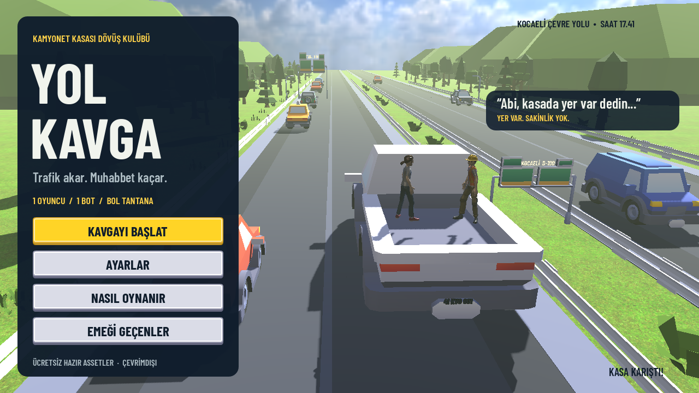
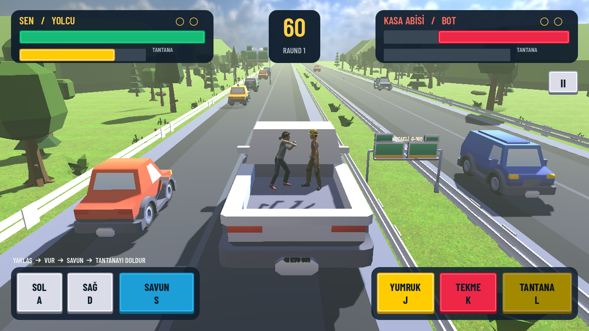

# Yol Kavga

Trafik akar. Muhabbet kaçar. Açık kasalı bir ticari aracın arkasında, akan trafiğin ortasında bir botla kapıştığın komik bir Android oyunu.

Godot **4.6.3**, 3D sahne, yatay ekran, Türkçe arayüz ve çoklu dokunmatik kontrol. Modeller, karakter animasyonları, düğme görselleri, efekt dokuları ve sesler internetten indirilen hazır **CC0** varlıklardır. Yazı tipi ücretsiz **SIL OFL** lisanslıdır. Oyun için grafik, model veya ses üreten kod kullanılmaz; GDScript oynanışı ve arayüz davranışını yönetir.





## Oyunda neler var?

- İki yönde akan trafik, yeşil çevre yolu ve açık kasalı kamyonet.
- Dokulu çim alanlar, meşe ve çamlar, çalılar, otlar, çiçekler ve yeşil tepeler.
- Çim refüj, kesintisiz metal bariyerler, yön tabelaları ve hazır bulutlu gökyüzü panoraması.
- Hazır yumruk, tekme, darbe alma, düşme ve özel hareket animasyonları.
- Can barları, 60 saniyelik raundlar, iki raund kazanınca biten maç.
- Savunma, vuruş serileri, biriktirilen **Tantana** özel hareketi.
- Üç bot zorluğu; kamera sarsıntısı, titreşim, ses seviyesi ve büyük düğme ayarları.
- Ana menü, nasıl oynanır, asset kredileri, duraklatma, sonuç ve rövanş ekranları.
- Cihazda kalıcı ayarlar; uygulama arka plana geçince otomatik duraklatma.

## Android'e yükleme

APK'yi **[GitHub Releases](https://github.com/mehmet9978/yolkavga/releases)** sayfasındaki en son sürümden indir. Dosya adı `YolKavga-debug.apk`; yanında dosyanın SHA-256 bilgisini içeren `SHA256SUMS.txt` bulunur. APK kaynak repoya eklenmez.

Güncel kaynak için GitHub'da **Actions → Android APK** iş akışının başarılı çalışmasından **YolKavga-Android** artifact'ini indirip ZIP'i açabilirsin. İş akışı her `main` güncellemesinde çalışır; **Run workflow** ile de başlatılabilir.

APK'yi telefonda aç ve dosyayı açtığın uygulama için Android'in istediği kurulum iznini ver. Uygulama adı **Yol Kavga**, paket adı `com.mehmet9978.yolkavga`. ARM64 telefonlar ve x86_64 test cihazları için paketlenir; Android 7.0 ve üzerini hedefler. Bu, debug imzalı bir deneme sürümüdür.

Google Play yayını için kendi release anahtarınla imzalanmış AAB üretmelisin. Anahtarları ve parolaları repoya koyma. [Android derleme yönergesi](docs/ANDROID.md).

## Godot ile açma

1. Godot **4.6.3 Standard** sürümünü kur.
2. Bu repoyu indir veya klonla.
3. Godot'ta `project.godot` dosyasını içe aktar; hazır modellerin ilk içe aktarılmasını bekle.
4. **F6** yerine tüm projeyi çalıştırmak için **F5** kullan.

Mobil için OpenGL Compatibility render yolu kullanılır. Harici eklenti veya ücretli bağımlılık gerekmez.

## Kontroller

| Eylem | Telefon | Klavye |
| --- | --- | --- |
| Hareket | SOL / SAĞ düğmesine basılı tut | A / D veya sol / sağ ok |
| Yumruk | YUMRUK | J |
| Tekme | TEKME | K |
| Savunma | SAVUN düğmesine basılı tut | S veya aşağı ok |
| Özel hareket | Sarı bar dolunca TANTANA | L |
| Duraklat / devam | II / Android geri tuşu | Esc |

Menzile girmek için yaklaş. Tekme daha uzağa ulaşır ve daha yavaş toparlanır. Savunma hasarı azaltır. Vurmak ve savunmak özel hareket barını doldurur. Süre dolarsa daha fazla canı olan raundu kazanır; eşit can beraberliktir. İki raund alan maçı kazanır.

## Doğrulama

```bash
godot --headless --editor --path . --import --quit
godot --headless --path . --script tests/smoke.gd
```

Gerçek Godot arayüz olaylarıyla menü, çoklu dokunma, parmak bırakma, yumruk ve duraklatma kontrolü (ekran gerekir; Linux CI için Xvfb kullanılabilir):

```bash
godot --path . --script tests/touch.gd
```

Test; ekran geçişlerini, isabet ve menzil kurallarını, savunmayı, özel hareket barını, kameraya göre hareketi, çoklu dokunmayı, duraklatmayı, raund sonucunu, rövanşı ve botun tam bir maçı bitirmesini denetler. Android APK derlemesi ve APK imzası ayrıca doğrulanmıştır. Fiziksel Android cihazında performans ve dokunmatik oynanış testi bu ortamda yapılmadı.

## Dosyalar

- `scenes/`: ana sahne, kamera, ışık ve arena.
- `scripts/`: dövüşçü davranışı, bot, trafik, Türkçe ekranlar ve kayıtlı ayarlar.
- `assets/`: indirilen özgün hazır varlıklar ve lisans metinleri.
- `tests/`: oynanış kontrolü ve Godot'tan ekran görüntüsü alma aracı.
- `docs/ASSETS.md`: tüm varlıkların kaynakları, lisansları ve indirme bilgileri.
- `docs/asset-manifest.json`: her hazır varlık için SHA-256 ve kaynak paketi.

Gönderilen fotoğraf kompozisyon referansı olarak kullanıldı; fotoğrafın kendisi, üzerindeki kullanıcı adı ve gerçek araç plakası oyuna dahil edilmedi.

Oyun kodu MIT lisanslıdır. Hazır varlıkların ayrı lisansları `assets/licenses/` altında korunur.
